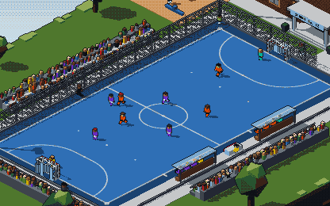
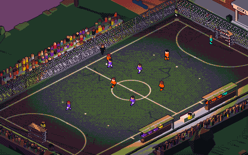
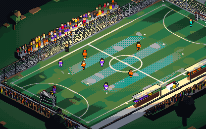
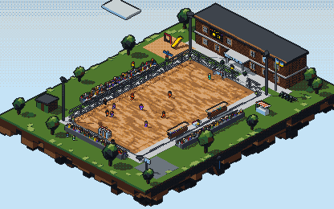
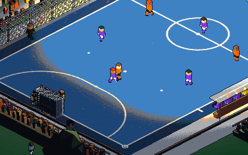

# Recess Futsal · School No. 12

A single-file, pixel-art 3D diorama of a five-a-side match on a floating school playground. Open it, and a full match plays itself: walk-out, warm-up, two halves, half-time changes, handshakes, then the next fixture.

**Play:** https://huit6985-ship-it.github.io/futsal-island/

| Dusk · asphalt | Night · turf |
|---|---|
|  |  |
| **Full pitch · parquet** | **Close-up · night** |
|  |  |

## What's in it
- three.js r160 (jsDelivr), orthographic camera at 31°, 90° rotation with easing (Q / E, buttons, or swipe).
- Rendered at ~230–300 px tall and scaled up with `image-rendering: pixelated`. One post pass draws depth-Laplacian outlines and snaps every pixel to a 32-colour palette (plus the two kits), with separate day, dusk and night palettes.
- Four surfaces, each with its own texture and physics: rolling resistance, bounce restitution, skid and player grip.
- Ball physics with quadratic drag. Ground passes use the exact closed form for a ball decelerating at `a + k·v²`; lobs use the ballistic solution with drag correction.
- Players run on coroutines (walk-outs, half-time, handshakes, ball kids, the security guard) with A* over a 1 m navigation grid; in play they follow a 1-2-1 shape with press, support runs and interceptions.
- Futsal rules, simplified: kick-ins, goal clearances by the keeper, corners, accumulated fouls with a 10 m free shot from the sixth.
- Spectator calls: Shoot, Square ball, Long ball, or tap the court to choose where the next pass goes.

Original clubs and players. Built by Hark; art direction and copy drafts by Gemini, curated.
